# 經緯·Contexture v0.5.0 架构说明书与技术指南

**版本**：0.5.0  
**日期**：2026-06-07  
**定位**：后续开发设计指南与维护参照  
**适用读者**：核心开发者、系统维护者、集成开发者

---

## 目录

1. [项目概览与定位](#1-项目概览与定位)
2. [系统架构全景](#2-系统架构全景)
3. [核心模块详解](#3-核心模块详解)
4. [处理流程与数据流](#4-处理流程与数据流)
5. [后端能力与扩展机制](#5-后端能力与扩展机制)
6. [API / CLI 接口参照](#6-apicli-接口参照)
7. [配置体系](#7-配置体系)
8. [数据模型与类型定义](#8-数据模型与类型定义)
9. [测试体系与质量保障](#9-测试体系与质量保障)
10. [开发指南与维护参照](#10-开发指南与维护参照)
11. [依赖清单与环境要求](#11-依赖清单与环境要求)
12. [演进路线与未来规划](#12-演进路线与未来规划)

---

## 1. 项目概览与定位

### 1.1 项目身份

| 属性 | 值 |
|------|-----|
| 名称 | 經緯·Contexture (AIH-Contexture) |
| 版本 | 0.5.0 |
| 许可证 | GPL-3.0-or-later |
| 语言 | Python 3.10+ |
| 构建系统 | Poetry |
| 发布形态 | 本地单用户 |

### 1.2 核心使命

Contexture 是面向人文学科的文献结构化平台。它将 PDF 和图片形态的学术文献转化为**保留双重页码锚点的结构化输出**，使数字化材料重新具备学术引用条件。

核心创新：**双重页码系统**

| 锚点类型 | 格式示例 | 用途 |
|---------|---------|------|
| PDF 机器页码 | `{192}` | 精确定位到 PDF 文件物理页，支持自动跳转 |
| 印刷页码 | `<!-- Page: 170 -->` | 对应书籍实际印刷页码，用于学术引用 |

### 1.3 在 AIH-Infra 中的位置

Contexture 是三层架构的第一层（Layer 1）：

```
┌─────────────────────────────────────────────────────────┐
│  Layer 3: AIH-Infra MCP Server (Agent 任务网关)         │
│  ─ 将知识库能力封装为标准化 MCP 工具供外部 Agent 调用    │
├─────────────────────────────────────────────────────────┤
│  Layer 2: Open WebUI AIH-Infra v1.3 (可追溯知识问答)    │
│  ─ 向量知识库 / RAG 检索 / 页码级引证 / 证据导出        │
├─────────────────────────────────────────────────────────┤
│  Layer 1: 經緯·Contexture v0.5 (文献结构化)  ◀── 本项目 │
│  ─ PDF → Middle JSON → Scholarly Markdown               │
└─────────────────────────────────────────────────────────┘
```

页码锚点系统贯穿三层，实现从 PDF 源文件到最终 AI 生成引证的端到端追溯。

### 1.4 版本规模

| 指标 | 数值 |
|------|------|
| 总文件数 | 583 |
| 包内 Python 文件 | 313 |
| 测试文件 | 147 |
| 顶层包模块 | 19 |
| 测试通过数 | 285 |

---

## 2. 系统架构全景

### 2.1 总体架构图

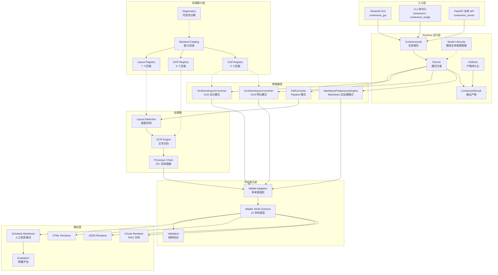

### 2.2 目录结构

```
aih-contexture-0.5.0/
├── contexture_app.py              # GUI 启动器
├── contexture_server.py           # API 启动器
├── convert.py / convert_single.py # CLI 启动器
├── configs/                       # 配置文件
│   ├── _app_settings.json
│   ├── api_profiles/              # 模型 API 配置 (gpt-5.4, kimi...)
│   ├── sidecar_backends.example.json
│   └── vlm_specialized_backends.example.json
├── aih_contexture/                # ═══ 主包 (313 Python 文件) ═══
│   ├── runtime/                   # 运行层 (任务/结果/分发/产物)
│   ├── middle/                    # 中间表示 (Schema/Adapter/Validation)
│   ├── backends/                  # 后端能力 (Catalog/Diagnostics/Registry)
│   ├── converters/                # 转换器 (PDF/VLM/OCR)
│   ├── processors/                # 后处理链 (20+ 处理器)
│   ├── postprocess/               # Markdown 后处理引擎
│   ├── evaluation/                # 质量评估系统
│   ├── services/                  # 外部服务抽象 (OCR/VLM/API Provider)
│   ├── renderers/                 # 输出渲染器 (MD/HTML/JSON/Chunk)
│   ├── prompts/                   # VLM Prompt 管理
│   ├── builders/                  # Pipeline 构建器
│   ├── extractors/                # 数据提取工具
│   ├── vendor/                    # 外部模型协议兼容层
│   ├── scripts/                   # CLI 入口 + UI 辅助模块
│   │   └── ui/                    # Streamlit UI helper
│   ├── config/                    # 配置解析
│   ├── schema/                    # Schema 定义
│   ├── templates/                 # 文档处理模板
│   └── utils/                     # 通用工具
├── tests/                         # 测试 (147 文件)
├── .github/workflows/             # CI (benchmarks/ci/publish/scripts)
└── data/ examples/ assets/        # 示例数据与资源
```

### 2.3 设计原则

| 原则 | 实现方式 |
|------|---------|
| 可追溯性为第一公理 | 双重页码锚点贯穿全链路 |
| 层间松耦合 | Runtime/Middle/Backend 三层可独立演进 |
| 后端可替换 | Catalog + Registry + Diagnostics 机制 |
| 显式知识边界 | Middle JSON schema 严格约束块类型与元数据 |
| 学者可及性 | 无 GPU 可用核心功能；有 API key 即可运行 VLM 模式 |

---

## 3. 核心模块详解

### 3.1 Runtime 运行层 (`aih_contexture/runtime/`)

运行层是系统的调度中枢，统一 GUI、CLI、API 三种入口的任务执行边界。

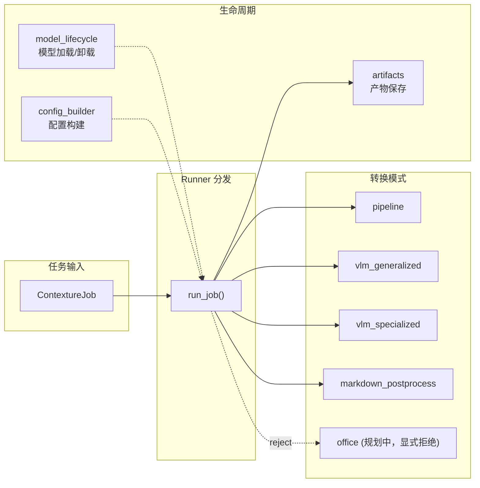

**模块职责清单：**

| 模块 | 职责 |
|------|------|
| `job.py` | 定义 `ContextureJob`（输入规约）和 `ContextureResult`（输出规约）；声明 `ContextureMode` 类型字面量 |
| `runner.py` | 核心分发：接收 Job → 选择转换器 → 返回 Result |
| `artifacts.py` | 输出持久化：MD/HTML/JSON/Chunk、Middle JSON 产物、图像保存、批量合并 |
| `config_builder.py` | 从用户选项构建运行时配置 |
| `ui_config.py` | UI 特定配置适配边界 |
| `model_lifecycle.py` | 模型加载/卸载管理（prepare/finish） |
| `vlm_middle.py` | 从 VLM 输出提取 Middle JSON |
| `vlm_repair.py` | VLM 页面修复/重渲染逻辑 |
| `backend_field_sets.py` | 后端特定配置字段集 |
| `subprocess_stream.py` | 外部进程流式执行 |
| `errors.py` | 运行时错误类型定义（`ContextureConfigError` 等） |

### 3.2 Middle JSON 中间表示层 (`aih_contexture/middle/`)

Middle JSON 是系统的统一数据交换格式——所有转换路径最终都汇聚到此，再渲染为各种输出格式。

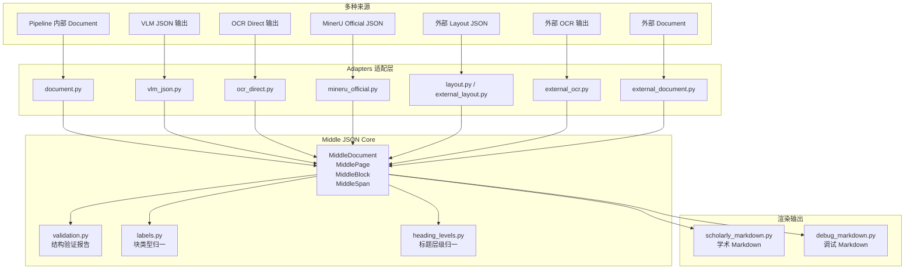

**21 种规范块类型：**

| 类别 | 块类型 |
|------|--------|
| 基础文本 | `Text`, `SectionHeader`, `ListItem`, `Code` |
| 页面结构 | `PageHeader`, `PageFooter`, `PageNumber` |
| 学术注释 | `Footnote`, `MarginalNote`, `InlineAnnotation`, `Reference` |
| 视觉元素 | `Figure`, `Picture`, `ImageDescription`, `Caption` |
| 结构化内容 | `Table`, `Equation`, `Form`, `TableOfContents` |
| 特殊 | `Handwriting`, `ComplexRegion` |

**Scholarly Markdown 渲染规则：**

| 元素 | 渲染格式 | 示例 |
|------|---------|------|
| 页锚点 | `{n}` | `{0}`, `{1}`, `{192}` |
| 印刷页码 | `<!-- Page: X -->` | `<!-- Page: 170 -->` |
| 标题 | Markdown `#` 层级 | `# Chapter Title` |
| 脚注引用 | `<sup>n</sup>` | `<sup>3</sup>` |
| 脚注正文 | `<sup>n</sup> body` | `<sup>3</sup> 注释内容` |
| 边注 | `<!-- Margin:left/right -->` | 结构化 HTML 注释 |
| 图像说明 | 结构化注释块 | |

### 3.3 Backend 后端能力层 (`aih_contexture/backends/`)

后端层实现"发现-诊断-选择"三步机制，使系统不绑定任何单一引擎。

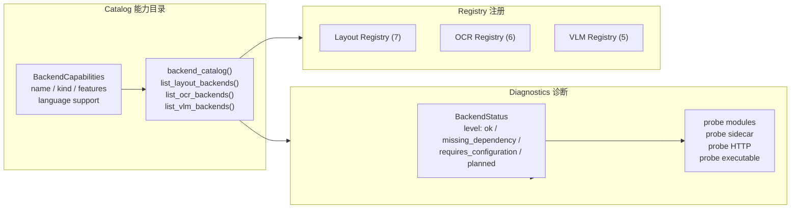

### 3.4 Builders 构建器层 (`aih_contexture/builders/`)

Builders 是 Pipeline 模式的核心编排层，负责将原始模型推理结果组装为结构化 `Document` 对象。

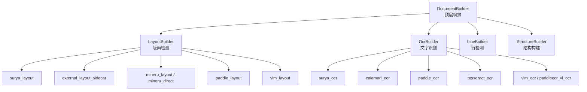

| Builder | 职责 |
|---------|------|
| `DocumentBuilder` | 顶层编排：协调 Provider → Layout → OCR → 行检测 → 结构化；管理 DPI 分别设置（Layout 低分辨率 / OCR 高分辨率） |
| `LayoutBuilder` | 运行 Layout 模型（Surya/Paddle/MinerU/VLM），将检测结果合并到 Document |
| `OcrBuilder` | 运行 OCR 模型，将识别文本写回 line/span 结构 |
| `LineBuilder` | 行级检测与合并 |
| `StructureBuilder` | 段落/标题/表格等结构化推断 |
| 各 Sidecar Builder | `mineru_layout.py`、`paddle_layout.py`、`paddle_ocr.py` 等：调用外部 Python 进程执行特定引擎 |

**Builder 与 Converter 的关系**：`PdfConverter` 调用 `DocumentBuilder` 完成文档构建后，再将 `Document` 传递给 Processor 链进行后处理。

### 3.5 Converters 转换器层 (`aih_contexture/converters/`)

| 转换器 | 类名 | 对应模式 | 职责 |
|--------|------|---------|------|
| Pipeline | `PdfConverter` | `pipeline` | 经典 Layout→OCR→Processor 流水线 |
| VLM 泛化 | `VlmDirectAsyncConverter` | `vlm_generalized` | 整页发送至云端 VLM，解析结构化响应 |
| VLM 特化 | `OcrDirectAsyncConverter` | `vlm_specialized` | 发送至专用模型 (Chandra/Churro) |
| 后处理 | `MarkdownPostprocessEngine` | `markdown_postprocess` | 对已有 Markdown 进行修复与增强 |

### 3.5 Processors 后处理链 (`aih_contexture/processors/`)

Pipeline 模式的核心增值环节。20+ 处理器按序对文档进行结构增强：

```mermaid
graph TD
    subgraph CORE["核心处理器"]
        PN["page_number.py<br/>页码提取与多候选评分"]
        PH["page_header.py<br/>页眉检测"]
        PF["page_footer.py<br/>页脚检测"]
        FN["footnote.py<br/>脚注检测"]
        FP["footnote_policy.py<br/>脚注策略"]
        MA["marginal_annotation.py<br/>7 类边注检测"]
        IA["inline_annotation.py<br/>5 类行内注检测"]
        SH["sectionheader.py<br/>章节标题处理"]
    end

    subgraph STRUCTURE["结构处理器"]
        ORD["order.py<br/>块排序"]
        BL["block_relabel.py<br/>块类型重标"]
        LM["line_merge.py<br/>行合并"]
        LN["line_numbers.py<br/>行号处理"]
        BP["blank_page.py<br/>空白页检测"]
        BQ["blockquote.py<br/>引用块检测"]
        MN["markdown_noise.py<br/>Markdown 噪声清理"]
        IG["ignoretext.py<br/>忽略文本处理"]
    end

    subgraph CONTENT["内容处理器"]
        TBL["table.py<br/>表格后处理"]
        EQ["equation.py<br/>公式处理"]
        CODE["code.py<br/>代码块检测"]
        LST["list.py<br/>列表检测"]
        REF["reference.py<br/>参考文献处理"]
        TXT["text.py<br/>文本处理"]
        TOC["document_toc.py<br/>目录提取"]
    end

    subgraph CORRECTION["校正处理器"]
        PPC["printed_page_correction.py<br/>印刷页码校正"]
        LLM_PPC["llm/ 子目录<br/>14 个 LLM 辅助处理器"]
    end

    CORE --> STRUCTURE --> CONTENT --> CORRECTION
```

**边注检测支持 7 种类型**（Stephanus 编码、Bekker 编码等）  
**行内注检测支持 5 种类型**（括注、双行小字、日本割注等）  
边注与行内注处理器默认关闭，通过 `enable_marginal_detection` / `enable_inline_detection` 按需开启。

**LLM 辅助处理器子目录 (`processors/llm/`)：**

| 模块 | 职责 |
|------|------|
| `llm_printed_page_correction.py` | LLM 辅助页码校正 |
| `llm_table.py` / `llm_table_merge.py` | LLM 辅助表格处理 |
| `llm_equation.py` / `llm_mathblock.py` | LLM 辅助公式识别 |
| `llm_sectionheader.py` | LLM 辅助标题检测 |
| `llm_image_description.py` | LLM 辅助图像描述 |
| `llm_complex.py` | LLM 辅助复杂区域处理 |
| `llm_form.py` | LLM 辅助表单处理 |
| `llm_handwriting.py` | LLM 辅助手写体处理 |
| `llm_noise_removal.py` | LLM 辅助噪声移除 |
| `llm_page_correction.py` | LLM 辅助页面修正 |
| `llm_meta.py` | LLM 处理器元信息 |

### 3.6 Postprocess 后处理引擎 (`aih_contexture/postprocess/`)

独立的 Markdown 后处理 runtime mode，对已有转换结果进行修复与增强：

| 模块 | 职责 |
|------|------|
| `markdown_engine.py` | `MarkdownPostprocessEngine` 主引擎 |
| `markdown_config.py` | `MarkdownPostprocessConfig` 配置数据类 |
| `printed_page_repair.py` | 页码序列异常检测 → 修复提案 → 应用修复 |
| `markdown_lm.py` | `MarkdownLMAdapter` 可选 LLM 审阅/修正 |
| `reporting.py` | `MarkdownPostprocessResult`, `PrintedPageAction` 结果报告 |

**典型输出后缀：**
- `.page_repaired.review.md` — 页码修复审阅稿
- `.page_repaired.md` — 页码修复定稿
- `.middle_rerendered.md` — Middle JSON 重渲染
- `.postprocess_report.json` — 后处理报告

### 3.7 Evaluation 质量评估系统 (`aih_contexture/evaluation/`)

| 模块 | 职责 |
|------|------|
| `layout_middle.py` | 评估 Layout→Middle 转换质量 |
| `layout_compare.py` | 对比不同 Layout 后端的输出差异 |
| `layout_overlay.py` | 生成可视化叠加图（检测块 → PDF 页面） |
| `scholarly_markdown.py` | 评估 Scholarly Markdown 结构质量（锚点、脚注、边注等） |

### 3.8 Services 服务抽象层 (`aih_contexture/services/`)

统一封装外部 OCR/VLM/API 服务的调用接口：

**OCR 服务：**
- `ocr_base.py` → 基类
- `ocr_calamari.py` → Calamari (历史欧洲印刷文本)
- `ocr_chandra.py` / `ocr_churro.py` → 专用 VLM
- `ocr_vlm.py` / `ocr_vlm_specialized.py` → VLM-backed OCR
- `ocr_tesseract.py` → Tesseract
- `ocr_factory.py` → 工厂方法

**API Provider（均在 services/ 中）：**
- `openai.py` → OpenAI / OpenAI-compatible
- `claude.py` → Anthropic Claude
- `gemini.py` → Google Gemini
- `azure_openai.py` → Azure OpenAI
- `ollama.py` → Ollama (本地)
- `vertex.py` → Google Vertex AI
- `lmstudio_native.py` → LM Studio (本地)

**Document Provider（`aih_contexture/providers/`）：**
- `pdf.py` → PDF 输入解析
- `image.py` → 图片输入
- `epub.py` → EPUB 电子书
- `html.py` → HTML 输入
- `powerpoint.py` → PPTX 输入
- `spreadsheet.py` → 电子表格输入
- `document.py` → DOCX 输入
- `registry.py` → Provider 注册表

### 3.9 Prompts 提示词管理 (`aih_contexture/prompts/`)

| 模块 | 职责 |
|------|------|
| `manager.py` | Prompt 组装管理器 |
| `presets.py` | 文档模板预设（通用现代印刷品、历史文献、中文古籍竖排、手写体） |
| `templates.py` | Prompt 模板构建块 |
| `builder.py` | Prompt 组装逻辑 |
| `api_adapter.py` | 适配不同 API Provider 的 prompt 格式 |

### 3.10 Extractors 结构化数据提取 (`aih_contexture/extractors/`)

独立的 LLM 驱动数据提取子系统，支持从文档中按用户定义的 JSON Schema 提取结构化信息。

**两阶段提取流程**：

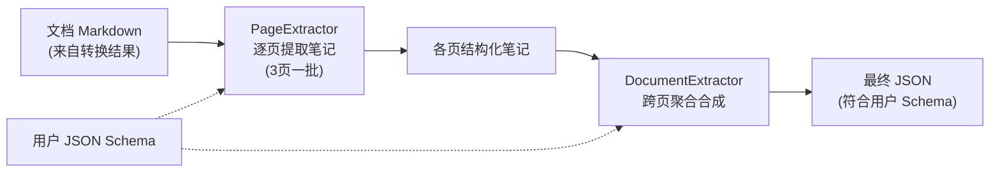

| 模块 | 职责 |
|------|------|
| `page.py` (`PageExtractor`) | 每 3 页一批，结合用户 Schema 提取页面级笔记 |
| `document.py` (`DocumentExtractor`) | 聚合全部页面笔记，合成符合 Schema 的最终 JSON |

**典型用例**：从 PDF 中按自定义 Schema 提取人名、引用关系、销售数据等结构化信息。

---

## 4. 处理流程与数据流

### 4.1 数据生命周期全景

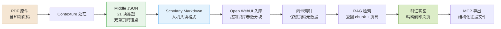

**数据形态变化表：**

| 阶段 | 形态 | 关键元数据 |
|------|------|-----------|
| 原件 | PDF 二进制 | 物理页面、印刷页码（肉眼可见） |
| 结构化 | Middle JSON | 块类型、双重页码锚点、层级结构、provenance |
| 交换格式 | Scholarly Markdown | `{192}` 机器锚点 + `<!-- Page: 170 -->` 印刷页 |
| 入库 | Vector chunks | chunk 内容 + page_number 元数据 + 章节标题链 |
| 检索 | RAG 结果 | 相关度分数 + 页码 + 所属文档 + 章节路径 |

### 4.2 Pipeline 模式详细流程

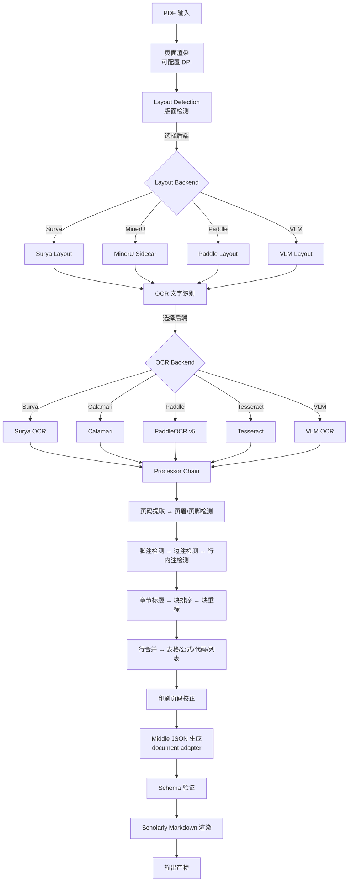

### 4.3 VLM 泛化模式流程

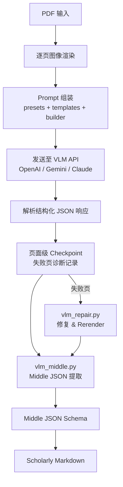

**VLM 泛化模式特点：**
- 支持页面级 checkpoint（断点续转）
- 失败页产生诊断记录（non-JSON、bad JSON、missing fields、HTTP errors、truncation、retry exhaustion）
- 可对失败页进行修复和重渲染

### 4.4 VLM 特化模式流程

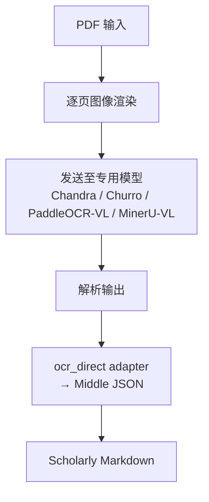

### 4.5 Markdown 后处理模式流程

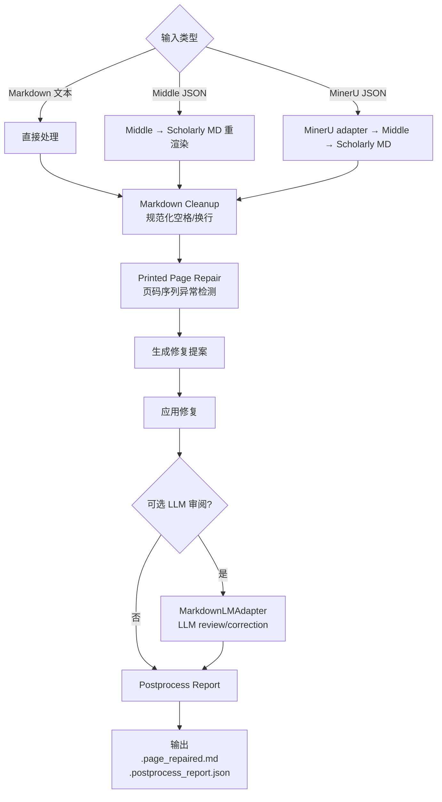

---

## 5. 后端能力与扩展机制

### 5.1 Layout 后端 (7 个)

| 后端 ID | 引擎 | 执行方式 | 特性 |
|---------|------|---------|------|
| `surya` | Surya Layout | 本地 PyTorch | 默认后端，通用性强 |
| `vlm_layout` | VLM Service | HTTP API | 适合复杂版面 |
| `external_layout_sidecar` | 外部 JSON | Sidecar 进程 | 接入 MinerU/Paddle/通用 layout |
| `mineru_pp_doclayout_v2` | MinerU Pipeline | CLI Sidecar | 调用 MinerU 全 pipeline |
| `mineru_pp_doclayout_v2_direct` | MinerU Layout Model | Sidecar | 仅 layout 模型 |
| `paddle_pp_doclayout_plus_l` | PaddleOCR Layout | Sidecar | Paddle Plus-L |
| `paddle_pp_doclayout_v3` | PaddleOCR Layout | Sidecar | Paddle V3 |

规划中：`humanities_layout_future`

### 5.2 OCR 后端 (6 个)

| 后端 ID | 引擎 | 执行方式 | 适用场景 |
|---------|------|---------|---------|
| `surya` | Surya OCR | 本地 PyTorch | 默认，多语言通用 |
| `vlm_ocr` | VLM Service | HTTP API | 复杂字体/手写体 |
| `calamari` | Calamari | HTTP Service | 历史欧洲印刷文本 |
| `paddle_ocr_v5` | PP-OCRv5 | Sidecar | 高精度中英文 |
| `paddleocr_vl_ocr` | PaddleOCR-VL | Sidecar | 视觉识别 |
| `tesseract` | Tesseract | 系统可执行文件 | 轻量/遗留兼容 |

规划中：`mineru_pytorch_paddle_ocr`

### 5.3 VLM 后端 (5 个)

| 后端 ID | 引擎 | 能力 |
|---------|------|------|
| `vlm_generalized` | 通用 VLM (GPT-5/Gemini/Claude/Kimi) | 整页理解、checkpoint、修复 |
| `chandra` | Chandra | 专用文档模型 |
| `churro` | Churro | 专用文档模型 |
| `paddleocr_vl` | PaddleOCR-VL | OCR/表格/图表/公式/印章/spotting |
| `mineru_vl` | MinerU-VL | Layout + Block Recognition |

### 5.4 扩展新后端的步骤

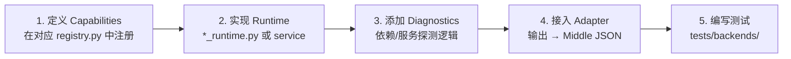

关键接口约定：
1. 在 `backends/{kind}/registry.py` 中注册 `BackendCapabilities`
2. 在 `backends/diagnostics.py` 中添加可用性探测
3. 实现从后端输出到 Middle JSON 的适配（如需）
4. Sidecar 后端需在 `configs/sidecar_backends.example.json` 中添加配置示例

---

## 6. API / CLI 接口参照

### 6.1 FastAPI 本地 API

服务地址：`127.0.0.1:8000`（默认）

> **安全边界**：本 API 设计为**本地可信环境**使用。无认证、无限速、无路径沙箱。不可直接暴露到公网或不可信网络。服务版本需额外引入 auth middleware 和输入验证。

| 端点 | 方法 | 功能 |
|------|------|------|
| `/` | GET | HTML 着陆页 |
| `/marker` | POST | Pipeline PDF 转换（JSON 参数） |
| `/marker/upload` | POST | Pipeline PDF 转换（multipart 上传） |
| `/v1/convert` | POST | 统一 Runtime 转换（全部 4 种模式） |
| `/v1/backends` | GET | 列出可用后端（可选诊断信息） |

**`/v1/convert` 请求体关键字段：**
```json
{
  "mode": "pipeline | vlm_generalized | vlm_specialized | markdown_postprocess",
  "input_path": "/path/to/file.pdf",
  "output_formats": ["markdown", "html", "json", "chunks"],
  "page_range": "1-10",
  "config": { /* 模式特定键值对 */ }
}
```

### 6.2 CLI 命令清单

**核心转换命令：**

| 命令 | 功能 |
|------|------|
| `contexture` | 批量 PDF 转换 |
| `contexture_single` | 单文件转换 |
| `contexture_chunk` | Chunk 模式转换 |
| `contexture_gui` | 启动 Streamlit Web GUI |
| `contexture_extract` | 启动数据提取应用 |
| `contexture_server` | 启动 FastAPI 本地 API |

**诊断与评估命令：**

| 命令 | 功能 |
|------|------|
| `contexture_doctor` | 后端可用性诊断检查 |
| `contexture_backends` | 查看后端能力目录 |
| `contexture_eval_layout` | Layout 质量评估 |
| `contexture_eval_markdown` | Scholarly Markdown 结构质量检查 |
| `contexture_visualize_layout` | Layout 检测可视化叠加图 |
| `contexture_compare_layout` | 对比不同 Layout 输出 |
| `contexture_download_layout_smoke` | 下载 Layout Smoke 测试数据 |

**导入命令（外部数据 → Middle JSON）：**

| 命令 | 输入来源 |
|------|---------|
| `contexture_middle` | Middle JSON 操作 |
| `contexture_import_document` | 外部 Document 输出 |
| `contexture_import_vlm_json` | VLM JSON 输出 |
| `contexture_import_ocr_direct` | OCR Direct 输出 |
| `contexture_import_layout` | 外部 Layout JSON |
| `contexture_import_ocr` | 外部 OCR 输出 |

**Sidecar 命令：**

| 命令 | 功能 |
|------|------|
| `contexture_paddle_ocr` | PaddleOCR Sidecar |
| `contexture_paddle_sidecar` | Paddle Layout Sidecar |
| `contexture_paddle_structure` | Paddle Structure |

---

## 7. 配置体系

### 7.1 配置文件结构

```
configs/
├── _app_settings.json                    # 应用级默认设置
├── api_profiles/                         # API Provider 预配置
│   ├── gpt-5.4.json
│   └── kimi.json
├── sidecar_backends.example.json         # Sidecar 外部 Python 解释器路径
└── vlm_specialized_backends.example.json # VLM 特化后端端点配置
```

### 7.2 Streamlit 配置

文件：`.streamlit/config.toml`

| 配置项 | 值 |
|--------|-----|
| 地址 | localhost:8501 |
| 上传限制 | 1024 MB |
| 主题 | Light |
| 使用统计 | 关闭 |

### 7.3 运行时配置层次

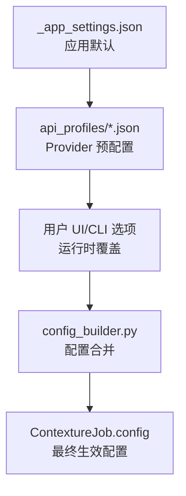

---

## 8. 数据模型与类型定义

### 8.1 ContextureJob（任务输入）

```python
@dataclass
class ContextureJob:
    # 输入源（三选一）
    input_path: str | None = None
    input_bytes: bytes | None = None
    input_name: str | None = None
    
    # 模式（默认 pipeline）
    mode: ContextureMode = "pipeline"
    # ContextureMode = Literal["pipeline", "vlm_generalized", "vlm_specialized", "office", "markdown_postprocess"]
    
    # 输出格式（默认仅 markdown）
    output_formats: list[str] = field(default_factory=lambda: ["markdown"])
    
    # 可选：页码过滤（页面索引列表）
    page_range: list[int] | None = None
    
    # 模式特定配置
    config: dict[str, Any] = field(default_factory=dict)
```

### 8.2 ContextureResult（任务输出）

```python
@dataclass
class ContextureResult:
    markdown: str | None = None
    html: str | None = None
    json_text: str | None = None
    chunks: str | None = None          # Chunk 渲染的文本输出
    page_count: int = 0
    middle_json: dict[str, Any] | None = None
    images: dict[str, Any] = field(default_factory=dict)
    metadata: dict[str, Any] = field(default_factory=dict)
    debug_artifacts: dict[str, Any] = field(default_factory=dict)
    warnings: list[str] = field(default_factory=list)
    file_outputs: list[dict[str, Any]] = field(default_factory=list)
```

### 8.3 Middle JSON Schema

```python
@dataclass
class MiddleProvenance:
    backend: str
    stage: str
    raw_label: str | None = None
    model: str | None = None
    confidence: float | None = None
    source: str | None = None
    notes: str | None = None

@dataclass
class MiddleSpan:
    text: str
    bbox: list[float] | None = None
    polygon: list[list[float]] | None = None
    confidence: float | None = None
    attrs: dict[str, Any] = field(default_factory=dict)
    provenance: list[MiddleProvenance] = field(default_factory=list)

@dataclass
class MiddleBlock:
    id: str
    type: CanonicalBlockType | str   # 21 种规范块类型之一
    page_index: int
    order: int
    text: str = ""
    anchor_start: int | None = None  # 默认 = page_index
    anchor_end: int | None = None    # 默认 = page_index + 1
    bbox: list[float] | None = None
    polygon: list[list[float]] | None = None
    confidence: float | None = None
    spans: list[MiddleSpan] = field(default_factory=list)
    children: list["MiddleBlock"] = field(default_factory=list)
    attrs: dict[str, Any] = field(default_factory=dict)
    provenance: list[MiddleProvenance] = field(default_factory=list)

@dataclass
class MiddlePage:
    index: int
    width: float
    height: float
    printed_page: str | None = None
    blocks: list[MiddleBlock] = field(default_factory=list)
    attrs: dict[str, Any] = field(default_factory=dict)
    provenance: list[MiddleProvenance] = field(default_factory=list)

@dataclass
class MiddleDocument:
    pages: list[MiddlePage] = field(default_factory=list)
    source_name: str = ""
    schema_version: str = "0.5"
    metadata: dict[str, Any] = field(default_factory=dict)
    backends: list[str] = field(default_factory=list)
```

### 8.4 BackendCapabilities

```python
@dataclass(frozen=True, slots=True)
class BackendCapabilities:
    name: str
    kind: BackendKind    # Literal["layout", "ocr", "vlm", "office", "postprocess"]
    display_name: str
    implemented: bool = True
    requires_service: bool = False
    optional_dependency: str | None = None
    # 运行环境
    supports_cpu: bool = True
    supports_gpu: bool = True
    # 能力标记
    supports_bbox: bool = False
    supports_span: bool = False
    supports_confidence: bool = False
    supports_vertical_text: bool = False
    supports_footnote: bool = False
    supports_marginalia: bool = False
    supports_tables: bool = False
    supports_formulas: bool = False
    # 语言支持
    languages: tuple[str, ...] = field(default_factory=tuple)
    notes: str = ""
```

### 8.5 BackendStatus

```python
@dataclass
class BackendStatus:
    level: str  # "ok" | "missing_dependency" | "requires_configuration" | "planned"
    message: str
    details: Optional[dict]
```

---

## 9. 测试体系与质量保障

### 9.1 测试框架

- **框架**：pytest（配置在 `pytest.ini`）
- **测试路径**：`tests/`
- **总文件数**：147 个测试文件
- **通过数**：285 个测试（发布状态）
- **标记**：`@pytest.mark.filename` 用于 PDF fixtures

### 9.2 测试目录结构

```
tests/
├── backends/         # 后端 catalog / diagnostics / registry 测试
├── middle/           # Middle JSON schema / validation / adapters 测试
├── runtime/          # Runner / Job / Artifacts / Config 测试
├── evaluation/       # 质量评估模块测试
├── formatters/       # 输出格式化测试
├── converters/       # 转换器集成测试
├── processors/       # 各处理器单元测试
├── services/         # 服务抽象层测试
├── providers/        # API Provider 测试
├── renderers/        # 渲染器测试
├── scripts/          # CLI 入口测试
├── vendor/           # 外部协议兼容测试
├── builders/         # Pipeline 构建器测试
├── config/           # 配置解析测试
├── utils/            # 工具函数测试
└── conftest.py       # 公共 Fixtures
```

### 9.3 CI 工作流

| 工作流 | 触发 | 内容 |
|--------|------|------|
| `ci.yml` | Push / PR | 单元测试 + Lint |
| `benchmarks.yml` | 手动 / Schedule | 性能基准测试 |
| `publish.yml` | Tag | 包发布 |
| `scripts.yml` | Push | CLI 脚本验证 |
| `cla.yml` | PR | 贡献者协议检查 |

### 9.4 代码质量

- **Linter/Formatter**：Ruff v0.9.10（配置在 `.pre-commit-config.yaml`）
- **Pre-commit Hooks**：自动运行 Ruff check + format

---

## 10. 开发指南与维护参照

### 10.1 环境搭建

```bash
# 基础安装
pip install poetry
poetry install

# 可选：安装开发依赖
poetry install --with dev

# 可选：安装 Paddle/MinerU sidecar 环境（需独立 Python）
# 参照 configs/sidecar_backends.example.json 配置路径
```

### 10.2 启动方式

```bash
# GUI 模式
contexture_gui
# 或
streamlit run contexture_app.py

# CLI 批量转换
contexture /path/to/pdfs --output_dir /path/to/output

# 单文件转换
contexture_single /path/to/file.pdf

# API 服务
contexture_server

# 后端诊断
contexture_doctor
```

### 10.3 错误处理模式

| 层级 | 错误处理方式 |
|------|------------|
| Runner | `ContextureConfigError`：无效模式/缺失输入/async 冲突 |
| Backend Diagnostics | 返回结构化 `BackendStatus`，不抛异常 |
| VLM 页面级 | 失败页产生诊断记录，不中断整个文档 |
| API Server | 捕获异常 → log → 返回 `{"success": false, "error": "..."}` |
| Validation | `MiddleValidationReport` 区分 errors（结构违规）和 warnings |
| Sidecar | 优雅处理缺失二进制/模块，不 crash |

### 10.4 添加新处理器

1. 在 `aih_contexture/processors/` 创建新文件
2. 实现处理器类（参照现有处理器的接口约定）
3. 在 `PdfConverter.default_processors` 中注册（或设为可选）
4. 编写 `tests/processors/test_xxx.py`
5. 如需用户可控，添加 enable 开关

### 10.5 添加新 Middle Adapter

1. 在 `aih_contexture/middle/adapters/` 创建适配器文件
2. 输入：外部格式数据
3. 输出：`MiddleDocument` 实例
4. 确保所有块使用 `normalize_block_type()` 归一化
5. 确保 provenance 字段正确标记来源
6. 编写对应测试

### 10.6 Streamlit UI 模块化模式

`aih_contexture/scripts/ui/` 目录包含 36 个 UI helper 模块，采用以下组织模式：

- **后端设置模块**：`surya_layout_settings.py`、`ocr_calamari_settings.py`、`paddle_ocr_settings.py` 等——每个后端对应独立的 UI 配置面板
- **Runner 模块**：`pipeline_file_runner.py`、`vlm_generalized_runner.py`、`vlm_batch_runner.py`——各模式的执行驱动
- **状态管理**：`task_state.py`、`task_thread.py`——异步任务在 Streamlit 中的状态追踪
- **配置组装**：`pipeline_config_sections.py`、`vlm_config.py`——将分散的设置面板组装为完整配置

添加新后端的 UI 支持时，创建对应的 `*_settings.py` 模块并在 `backend_selectors.py` 中注册即可。

### 10.7 关键维护注意事项

- **Middle JSON 是核心契约**：所有块类型修改都需更新 schema + validation + 所有 adapter
- **Scholarly Markdown 渲染规则变更**影响下游 Open WebUI 入库，需协同考虑
- **页码锚点格式 `{n}` 是三层共识**，修改需三层协调
- **默认处理器链变更**可能影响已有输出的回归基线
- **Sidecar 后端依赖独立 Python 环境**，路径配置错误是常见问题源

---

## 11. 依赖清单与环境要求

### 11.1 系统要求

| 要求 | 最低 | 推荐 |
|------|------|------|
| Python | 3.10 | 3.11+ |
| 操作系统 | Windows/Linux/macOS | — |
| GPU | 不强制 | CUDA GPU (Pipeline/本地模型) |
| 内存 | 8 GB | 16 GB+ |

### 11.2 核心依赖

| 包 | 用途 |
|----|------|
| `torch` | ML 模型推理运行时 |
| `surya-ocr` | 默认 OCR + Layout 引擎 |
| `transformers` | Hugging Face 模型加载 |
| `Pillow` | 图像处理 |
| `pydantic` / `pydantic-settings` | 数据验证与设置管理 |
| `PyMuPDF` | PDF 页面渲染与提取 |
| `pypdfium2` / `pypdf` | PDF 解析 |
| `opencv-python-headless` | 图像处理（Layout） |
| `openai` | OpenAI / OpenAI-compatible API |
| `anthropic` | Claude API |
| `google-genai` | Gemini API |
| `fastapi` / `uvicorn` | 本地 API 服务 |
| `streamlit` / `streamlit-ace` | Web GUI |
| `scikit-learn` | ML 辅助工具 |
| `rapidfuzz` | 模糊文本匹配 |
| `beautifulsoup4` / `lxml` | HTML/XML 解析 |
| `click` | CLI 框架 |
| `requests` / `aiohttp` | HTTP 客户端 |
| `numpy` | 数值计算 |
| `psutil` | 系统资源监控 |
| `huggingface-hub` | 模型下载 |
| `ftfy` | Unicode 文本修复 |
| `regex` | 高级正则表达式 |
| `pdftext` | PDF 文本层提取 |

### 11.3 可选依赖

| 包 | 用途 |
|----|------|
| `mammoth` | DOCX 处理 |
| `openpyxl` | XLSX 处理 |
| `python-pptx` | PPTX 处理 |
| `ebooklib` | EPUB 处理 |
| `weasyprint` | HTML 渲染 |

### 11.4 开发依赖

`pytest`, `pytest-mock`, `jupyter`, `datasets`, `tabulate`, `playwright`, `latex2mathml`, `apted`, `distance`

---

## 12. 演进路线与未来规划

### 12.1 当前版本边界 (0.5.0)

**已包含：**
- 本地单用户版本
- Streamlit UI / CLI / 本地 API bridge
- Runtime / Middle JSON / Backend Catalog / Evaluation / Vendor / Postprocess

**明确不包含：**
- 多用户 Web 应用
- 网页登录认证
- 服务队列
- 管理员控制台
- 分布式 Worker
- 公网任务提交 API

### 12.2 规划方向

| 方向 | 说明 |
|------|------|
| `office` 模式 | 计划支持 DOCX/XLSX/PPTX 直接转换 |
| 服务版本 | 多用户 + 任务队列 + 认证 |
| `humanities_layout_future` | 面向人文学科特化的 Layout 后端 |
| Document/Structure 后端 | 提升为独立 runtime mode |
| 多页 checkpoint 增强 | 更细粒度的断点续转 |

### 12.3 架构演进约束

在后续开发中应遵守的不变量：

1. **Middle JSON 作为唯一数据交换格式** — 新转换路径必须输出 Middle JSON
2. **双重页码锚点格式不变** — `{n}` + `<!-- Page: X -->` 是三层共识
3. **后端可替换** — 不引入与特定引擎的硬耦合
4. **本地优先** — 核心功能不依赖外部网络服务
5. **学术可追溯性为第一公理** — 所有架构决策以此为最终判据

---

## 附录 A：Vendor 兼容层

`aih_contexture/vendor/` 处理外部模型的协议适配：

| 模块 | 职责 |
|------|------|
| `paddleocr_vl_compat.py` | PaddleOCR-VL 协议适配 |
| `mineru_vl_compat/blocks.py` | MinerU-VL 块解析 |
| `mineru_vl_compat/table.py` | MinerU-VL 表格处理 |

## 附录 B：输出格式清单

| 格式 | 渲染器 | 用途 | 页码保留 |
|------|--------|------|---------|
| Markdown | `renderers/markdown.py` | 标准 Markdown 输出 | 通过页分隔符 |
| HTML | `renderers/html.py` | 富文本输出 | 页面分节 |
| JSON | `renderers/json.py` | 结构化文档树 | block.page_id |
| Chunks | `renderers/chunk.py` | RAG 系统分块输入 | `FlatBlockOutput.page` + `ChunkOutput.page_info` |
| OCR JSON | `renderers/ocr_json.py` | OCR 特定结构输出 | 页级组织 |
| Scholarly MD | `middle/scholarly_markdown.py` | 学术引用格式输出 | `{n}` + `<!-- Page: X -->` |
| Debug MD | `middle/debug_markdown.py` | 诊断格式输出 | 含 provenance/bbox |

**Chunk 渲染器对 RAG 的关键保障**：每个 `FlatBlockOutput` 携带 `page: int` 字段，`ChunkOutput` 携带 `page_info: Dict[int, dict]`（页面几何信息）和 `section_hierarchy: Dict[int, str]`（层级上下文）。这确保下游 RAG 系统可按页码检索并在引证中标注来源页。

## 附录 C：关键设计决策记录

| 决策 | 理由 |
|------|------|
| 移除 YOLO layout | 维护成本高，替代方案更成熟 |
| Middle JSON 独立为包 | 作为系统契约需独立演进 |
| Sidecar 模式隔离重依赖 | 避免基础安装膨胀 |
| `office` mode 显式拒绝 | 不把未发布能力暴露为可执行能力 |
| 边注/行内注默认关闭 | 保持默认行为稳定，按需开启 |
| Scholarly MD 作为人工校阅层 | 区别于 Middle JSON 的机器事实层 |

---

*本文档由代码分析生成，应随代码演进持续更新。*
